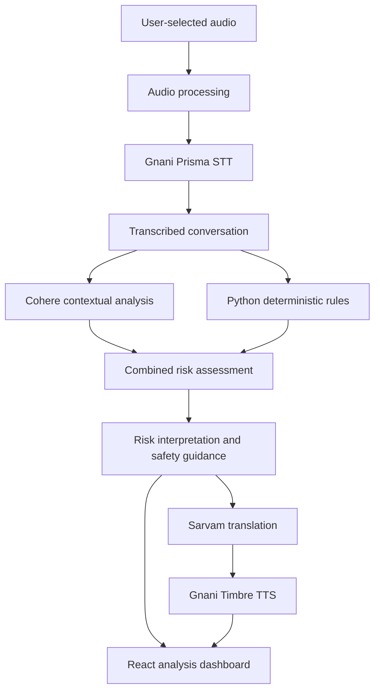

# TRUSTLINE 🛡️
### The Human Firewall for Voice Scams

**Hear the call. Understand the risk. Protect the decision.**

[](https://react.dev/)
[](https://fastapi.tiangolo.com/)
[](https://cohere.com/)
[](https://developer.mozilla.org/en-US/docs/Web/Progressive_web_apps)
[]()

**TRUSTLINE is an AI-powered, multilingual voice-safety companion that transforms suspicious conversations into understandable risk signals, evidence-based explanations, and actionable safety guidance.**

Scammers don't always sound suspicious. Sometimes they sound like your bank, a government official, a delivery executive, or someone you trust.

They exploit urgency. They manufacture fear. They manipulate decisions.

TRUSTLINE is built to give people something scammers don't want them to have: **a moment to think.**

---

## The Problem: Scams Exploit Human Trust

A suspicious call can involve an urgent account suspension warning, a fake delivery charge, an OTP request, a threatening legal notice, or pressure to transfer money immediately.

The problem isn't simply that people don't know scams exist. It's that recognising manipulation while experiencing it can be difficult.

People need more than another list of scam warnings. They need help understanding what is happening in a conversation, why it is concerning, and what they should do next.

## The Solution: Understand Before You Act

TRUSTLINE analyses user-provided audio through a layered intelligence pipeline combining speech recognition, contextual AI, deterministic detection, multilingual translation, and spoken safety guidance.

Rather than returning an unexplained suspicious/not-suspicious label, TRUSTLINE aims to make the analysis understandable.

It helps users explore:

- **What was said:** A transcript of the submitted conversation.
- **What looks suspicious:** Potential scam indicators and manipulation patterns.
- **Why it matters:** Contextual explanations of suspicious requests.
- **What to do next:** Practical guidance to reduce the risk of financial or personal harm.
- **How to understand it:** Multilingual and spoken safety guidance where supported.

The guiding philosophy:

> Don't just detect the warning sign. Explain it before someone makes a risky decision.

---

## Why TRUSTLINE?

TRUSTLINE takes a different approach from conventional scam-awareness experiences.

| Dimension | Scam-awareness and practice tools | TRUSTLINE |
|---|---|---|
| Primary focus | Learning to recognise scam scenarios | Understanding suspicious conversations |
| Interaction | Practice and awareness experiences | User-selected audio analysis |
| Intelligence | Scenario-based learning | Contextual AI and deterministic detection |
| Output | Training and awareness feedback | Risk interpretation and safety guidance |
| Accessibility | Depends on the learning experience | Multilingual translation and spoken guidance |
| Decision support | Builds awareness | Encourages pausing and independent verification |

TRUSTLINE is complementary to scam-awareness training tools. Its focus is the analysis and interpretation of suspicious conversations.

### What TRUSTLINE does not claim

TRUSTLINE is not a voice-cloning detector, deepfake authentication system, or caller identity verification service. It cannot guarantee that a conversation is fraudulent or that a low-risk result is safe. It identifies suspicious conversational indicators to support more informed decisions.

---

## The TRUSTLINE Experience

### 01 — Capture

Users submit an audio recording through the web application using the available upload or recording interface.

### 02 — Transcribe

Gnani Prisma STT converts submitted speech into text, creating the transcript for analysis.

### 03 — Understand

Cohere examines the transcript for contextual warning signs, suspicious requests, impersonation, pressure tactics, and manipulation.

### 04 — Cross-check

A Python-based deterministic rules engine independently examines transcript content for identifiable scam indicators.

### 05 — Assess

The contextual findings and deterministic indicators are combined into a structured risk assessment.

### 06 — Communicate

Sarvam supports multilingual translation, while Gnani Timbre provides text-to-speech functionality for spoken safety guidance.

The result is an understandable safety report rather than an unexplained prediction.

---

## Inside the Intelligence Pipeline



### A layered approach to scam detection

**Contextual Intelligence — Cohere**

Cohere analyses the meaning and context of the conversation to identify potentially suspicious behaviour.

Its structured responses are validated using Pydantic schemas. Unsupported transcript quotations are rejected instead of being presented as evidence.

**Deterministic Intelligence — Python**

The independent rules engine identifies predefined indicators from the transcript, including:

| Indicator | What it identifies |
|---|---|
| OTP harvesting | Requests for one-time passwords |
| Financial credential requests | Attempts to obtain banking or UPI credentials |
| Payment pressure | Urgent or suspicious payment demands |
| Impersonation | Claims of representing trusted organisations |
| Remote access | Requests to install or grant access to remote-control applications |
| Threats and intimidation | Fear-based pressure and consequences |
| Secrecy | Instructions to hide the interaction from others |

**Speech Recognition — Gnani Prisma**

Converts submitted audio into a transcript for downstream analysis.

**Multilingual Intelligence — Sarvam**

Supports translation of safety guidance to improve accessibility.

**Spoken Guidance — Gnani Timbre**

Converts generated safety messages into speech where the service is available.

### Why use two analysis layers?

Contextual AI and deterministic rules solve different problems.

Contextual AI can interpret the meaning of a conversation. Deterministic rules can identify specific, predefined patterns.

Combining their findings creates a more transparent analysis architecture than relying entirely on one model response.

Rule weights are ordinal indicators, not calibrated probabilities.

When contextual analysis fails, TRUSTLINE can return a clearly identified deterministic-only result. Translation and speech generation also have text-based fallbacks.

---

## PAUSE & VERIFY — The Decision Shield

**The most important moment in a scam is the moment before someone acts.**

A caller may demand an OTP, request a UPI PIN, insist on an immediate transfer, or pressure someone into installing an application.

TRUSTLINE's product direction centres on a simple principle:

**PAUSE. UNDERSTAND. VERIFY.**

| Situation | Safer response |
|---|---|
| Someone requests an OTP | Never share your OTP |
| Someone asks for a UPI PIN | Never disclose your PIN |
| Someone demands an immediate transfer | Stop and verify independently |
| Someone requests remote access | Do not install or grant access |
| Someone threatens immediate consequences | Contact the organisation through an independently verified channel |

The broader PAUSE & VERIFY direction includes evidence-linked transcript findings, explanations of manipulation tactics, and practical next steps.

These are product-development goals; the complete decision-shield workflow should not be considered implemented unless it is available in the deployed application.

---

## Technology Stack

| Layer | Technologies |
|---|---|
| Frontend | React, TypeScript, Vite |
| Backend | Python, FastAPI |
| AI analysis | Cohere |
| Speech recognition | Gnani Prisma STT |
| Scam detection | Python deterministic rules |
| Translation | Sarvam |
| Text-to-speech | Gnani Timbre |
| Validation | Pydantic |
| PWA | Service Workers |
| Browser storage | localStorage |
| Deployment | Vercel and backend hosting |

---

## Application Architecture

### Frontend

The frontend is built with React, TypeScript, and Vite, with a Progressive Web App architecture.

Its main components include:

| Component | Purpose |
|---|---|
| `AudioRecorder` | Audio recording interface |
| `AudioUploader` | Audio file submission |
| `SampleAudioSelector` | Demonstration audio selection |
| `AnalysisReportView` | Analysis report presentation |
| `AnalysisTimeline` | Conversation analysis timeline |
| `RiskBadge` | Risk-level presentation |
| `ProtectionCard` | Safety recommendations |
| `OfflineIndicator` | Connectivity status |

The application includes Landing, Onboarding, Dashboard, Analysis, How It Works, Family, Settings, and Evaluation pages.

### Backend

The FastAPI backend coordinates speech recognition, AI analysis, deterministic detection, risk assessment, translation, and speech generation.

| Module | Responsibility |
|---|---|
| `main.py` | API application and routes |
| `scam_engine/rules.py` | Deterministic detection |
| `services/gnani_stt.py` | Speech recognition |
| `services/cohere_analyzer.py` | Contextual analysis |
| `services/sarvam_translator.py` | Translation |
| `services/gnani_tts.py` | Speech generation |
| `services/pipeline.py` | Pipeline orchestration |

---

## Project Structure

```text
TRUSTLINE/
│
├── frontend/
│   ├── src/
│   │   ├── components/
│   │   ├── pages/
│   │   ├── services/
│   │   ├── context/
│   │   └── hooks/
│   └── public/
│
├── backend/
│   ├── scam_engine/
│   ├── services/
│   ├── evaluation/
│   └── main.py
│
├── docs/
│   ├── ARCHITECTURE.md
│   ├── DETECTION_METHODOLOGY.md
│   ├── DETECTION_IMPROVEMENTS.md
│   ├── DETECTION_ERROR_ANALYSIS.md
│   ├── EVALUATION_REPORT.md
│   ├── EVALUATION_METHODOLOGY.md
│   ├── SECURITY_AND_PRIVACY.md
│   ├── DEPLOYMENT.md
│   ├── KNOWN_LIMITATIONS.md
│   ├── DEMO_SCRIPT.md
│   ├── PITCH_DECK_OUTLINE.md
│   ├── COMPETITION_DEMO.md
│   └── COMPETITION_READINESS_AUDIT.md
│
└── README.md
```

---

## Getting Started

### Prerequisites

- Node.js and npm
- Python 3.10+
- Git
- Required API credentials for external services

### Clone the repository

```bash
git clone https://github.com/ManyaValecha/TRUSTLINE.git
cd TRUSTLINE
```

### Start the frontend

```bash
cd frontend
npm install
npm run dev
```

### Start the backend

Open another terminal:

```bash
cd backend
python -m venv venv
```

Activate the virtual environment.

**macOS/Linux**

```bash
source venv/bin/activate
```

**Windows**

```bash
venv\Scripts\activate
```

Install dependencies:

```bash
pip install -r requirements.txt
```

Start the FastAPI server:

```bash
uvicorn main:app --reload
```

### Environment configuration

Configure the required provider credentials in the backend environment using the exact variable names expected by the current implementation.

Example configuration:

```env
COHERE_API_KEY=
GNANI_API_KEY=
SARVAM_API_KEY=
```

Never commit API credentials, private keys, or other secrets to GitHub.

Refer to the deployment documentation for the exact provider configuration.

---

## Evaluation: Measuring Detection Behaviour

Trustworthy safety software requires transparent evaluation, not just impressive-looking metrics.

TRUSTLINE includes a synthetic, text-only benchmark for examining the behaviour of its deterministic detection rules.

### Current evaluation snapshot

| Metric | Result |
|---|---:|
| Authored transcripts | 220 |
| Scenario families | 35 |
| Deterministic rules accuracy | 98.6% |
| Deterministic rules recall | 97.5% |
| False-positive rate | 0.0% |
| Grouped 44-record repartition recall | 87.5% |

### Interpreting the results

The reported results are from authored examples and must not be interpreted as real-world scam detection performance.

The 100% development-split result suggests strong fit to the development examples, not demonstrated generalisation.

A grouped 44-record repartition produced 87.5% recall and exposed missed courier and customs scam scenarios.

This evaluation is not independent, blind, or representative real-world validation. Complete audio-pipeline performance, AI-only performance, and provider-backed hybrid performance have not been established.

### Reproducing the benchmark

From the backend directory:

```bash
PYTHONPATH=.. python -m evaluation.generate_dataset
PYTHONPATH=.. python -m evaluation.run_benchmark
```

### Running automated tests

```bash
cd backend
PYTHONPATH=. python -m pytest -q -p no:cacheprovider
```

The evaluation documentation provides further details about methodology, assumptions, limitations, and detection errors.

---

## Privacy, Security & Limitations

Voice recordings and transcripts can contain highly sensitive personal information.

TRUSTLINE's current implementation has important data-handling considerations:

- Submitted audio is sent to the backend and external providers for processing.
- Transcripts and reports are stored in browser localStorage.
- Generated warning audio may remain on the backend filesystem.
- Trusted-contact details are stored locally in the current implementation.
- The browser MVP does not monitor cellular calls in the background.
- Audio uploads are limited to 20 MiB.
- Trusted contacts do not currently receive automatic notifications.

Users should submit only recordings they have permission to share.

Production deployment requires clearly defined data-retention policies, secure storage, access controls, and a review of third-party provider data-handling practices.

A low-risk result means that no major indicators were found. It does not guarantee that a conversation is safe.

---

## Product Roadmap

TRUSTLINE's development direction focuses on making scam analysis more explainable, accessible, and useful.

| Area | Direction |
|---|---|
| Evidence Mode | Connect suspicious findings to exact transcript excerpts and timestamps |
| Scam Tactic Breakdown | Explain urgency, impersonation, threats, secrecy, and manipulation |
| PAUSE & VERIFY | Translate findings into actionable safety guidance |
| Multilingual Accessibility | Expand language support and spoken explanations |
| Family Safety | Develop consent-based incident sharing |
| Detection Evaluation | Expand scenario diversity and independent validation |
| Privacy Engineering | Strengthen retention policies and user controls |

These represent product-development directions, not claims that every capability is already implemented.

---

## Deployment

The frontend and backend have been deployed, with basic health, CORS, and frontend API configuration checks reported.

However, provider credentials were not configured in the current Vercel API project at the time of the latest deployment review. Fully functional provider-backed production audio analysis has therefore not been verified.

See `docs/DEPLOYMENT.md` for deployment details.

---

## Engineering Principles

**Explainability over unexplained scores**

Every warning should help users understand why a particular behaviour may be suspicious.

**Evidence over assumptions**

Transcript quotations must be grounded in the actual transcript. Unsupported model-generated quotations are rejected.

**Layered intelligence**

Contextual AI and deterministic rules contribute different forms of analysis.

**Honest uncertainty**

TRUSTLINE communicates the limitations of its detection approach rather than presenting ordinal rule weights as fraud probabilities.

**Graceful degradation**

The application provides clearly identified fallbacks when external AI, translation, or speech services are unavailable.

**Privacy-aware design**

The project documents its current data-handling limitations and avoids claiming background call monitoring or automatic family notifications that the current MVP does not provide.

---

## Documentation

| File | Description |
|---|---|
| `ARCHITECTURE.md` | System architecture |
| `DETECTION_METHODOLOGY.md` | Detection methodology |
| `DETECTION_IMPROVEMENTS.md` | Detection improvements |
| `DETECTION_ERROR_ANALYSIS.md` | Error analysis |
| `EVALUATION_REPORT.md` | Benchmark results |
| `EVALUATION_METHODOLOGY.md` | Evaluation methodology |
| `SECURITY_AND_PRIVACY.md` | Security and privacy |
| `DEPLOYMENT.md` | Deployment instructions |
| `KNOWN_LIMITATIONS.md` | Known limitations |
| `DEMO_SCRIPT.md` | Demonstration script |
| `COMPETITION_DEMO.md` | Competition demonstration |
| `COMPETITION_READINESS_AUDIT.md` | Readiness assessment |

---

## The Vision

A scammer doesn't always need to hack a device.

Sometimes, one convincing conversation is enough.

One OTP shared. One transfer made. One moment of panic.

TRUSTLINE is built to help people recognise suspicious behaviour, understand the evidence, and make more informed decisions before acting.

By bringing together AI, speech technology, deterministic detection, and multilingual safety guidance, TRUSTLINE aims to make digital interactions easier to question and safer to navigate.

> **A scammer creates urgency. TRUSTLINE creates a moment to think.**

---

## Connect

**Developer:** Manya Valecha

**Project:** TRUSTLINE — The Human Firewall for Voice Scams

**GitHub:** [ManyaValecha/TRUSTLINE](https://github.com/ManyaValecha/TRUSTLINE)

**LinkedIn:** [Manya Valecha](https://www.linkedin.com/in/manyavalecha/)

**Built with:** React · TypeScript · Python · FastAPI · Cohere · Gnani · Sarvam

---

<sub>TRUSTLINE is an experimental safety-support application. It does not guarantee fraud detection, authenticate caller identity, or replace official fraud reporting channels, financial institutions, or professional security services.</sub>
