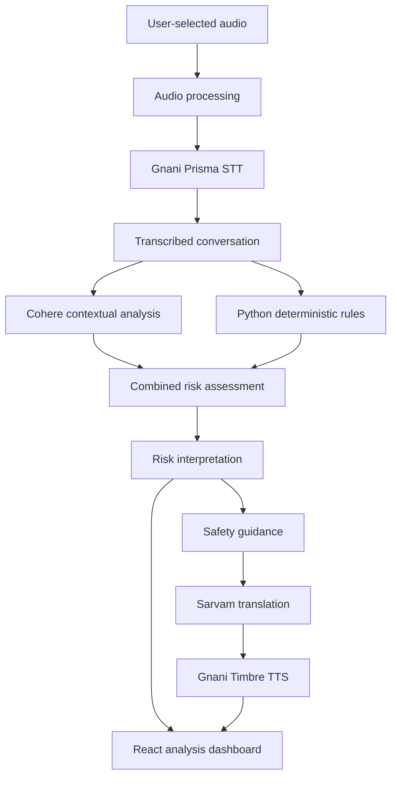

# TRUSTLINE 🛡️
### The Human Firewall for Voice Scams 

**Hear the call. Understand the risk. Protect the decision.**

[](https://react.dev/)
[](https://fastapi.tiangolo.com/)
[](https://cohere.com/)
[](https://developer.mozilla.org/en-US/docs/Web/Progressive_web_apps)
[]()

**TRUSTLINE is an AI-powered, multilingual voice-safety companion designed to help people understand suspicious conversations, recognise potential scam indicators, and make safer decisions before acting.**

A scammer doesn't always sound like a scammer.

Sometimes, they sound like your bank. A government official. A delivery executive. Or someone you trust.

They create urgency. They manufacture fear. They exploit trust.

TRUSTLINE brings together speech recognition, contextual AI, deterministic detection, multilingual translation, and spoken guidance to help people understand what may be happening during a suspicious conversation.

**Because recognising a scam is important. Knowing what to do next matters even more.**

---

## The Problem: A Convincing Voice Can Manipulate a Decision

Imagine receiving a call:

*"Your bank account will be blocked in ten minutes. To prevent this, share the OTP we just sent you."*

The caller sounds confident. The situation sounds urgent. The person receiving the call has little time to think.

This is how social engineering works: it exploits human behaviour, not just technical vulnerabilities.

People need more than another list of scam warnings. They need help understanding suspicious conversations, identifying concerning requests, and deciding how to respond.

## The TRUSTLINE Approach

TRUSTLINE turns user-submitted audio into an understandable safety report through a layered analysis pipeline.

The experience brings together:

| Capability | Purpose |
|---|---|
| Speech recognition | Convert submitted audio into text |
| Contextual AI | Interpret suspicious conversational behaviour |
| Deterministic detection | Identify predefined scam indicators |
| Risk assessment | Combine analysis findings into a structured result |
| Multilingual translation | Make safety guidance more accessible |
| Spoken guidance | Communicate warnings through generated speech where available |

Instead of relying on an unexplained suspicious/not-suspicious label, TRUSTLINE is designed to help users understand the conversation and the warning signs within it.

> **Don't just detect the warning sign. Explain it before someone makes a risky decision.**

---

## How TRUSTLINE Works

### 01 — Capture

Users submit a suspicious audio recording through the available recording or upload interface.

### 02 — Transcribe

Gnani Prisma v3 STT transcribes Indian-language speech. Choose Indic auto-detection, a supported language, or one of three code-switch profiles: Hinglish (Hindi + English), Tanglish (Tamil + English), and Benglish (Bengali + English). The code-switch profiles pass likely-language hints and request code-mix text so English terms stay readable in Latin script. Supported WAV, MP3, FLAC, OGG, and M4A uploads are preserved to retain source sampling and codec details, including native 8 kHz call audio; unsupported browser recordings are converted to mono 16 kHz WAV. The REST model currently accepts clips up to 30 seconds.

The current Prisma v3 integration documents ten language choices: Bengali, English (India), Gujarati, Hindi, Kannada, Malayalam, Marathi, Punjabi, Tamil, and Telugu. This is not coverage of every Indian language or dialect. Browser recordings request echo cancellation, noise suppression, and automatic gain control where supported. TRUSTLINE does not apply denoising to uploads, and real noisy-call accuracy has not yet been measured.

Gnani Timbre v3.0 can speak the safety warning in those ten supported locales. The app includes fictional generated Hinglish, Tanglish, and Benglish call samples plus narrow-band noisy test variants; these provide reproducible demos, not evidence of real-call accuracy.

### 03 — Understand

Cohere analyses the transcript for contextual warning signs, suspicious requests, impersonation, pressure tactics, and manipulation.

### 04 — Cross-check

A Python-based deterministic rules engine independently examines transcript content for predefined scam indicators.

### 05 — Assess

The contextual findings and deterministic indicators are combined into a structured risk assessment.

### 06 — Communicate

Sarvam supports multilingual translation, while Gnani Timbre v3.0 generates compressed spoken guidance for ten supported language locales. The analysis response carries the audio inline for playback in the report.

The result is an analysis experience designed to make suspicious conversational behaviour easier to understand.

---

## Inside the Intelligence Pipeline



### Two complementary intelligence layers

**Contextual AI — Cohere**

Cohere interprets the meaning and context of the transcript to identify potentially suspicious behaviour.

Its structured responses are validated using Pydantic schemas. Unsupported transcript quotations are rejected rather than presented as evidence.

**Deterministic detection — Python**

The independent rules engine identifies predefined indicators in transcript content.

| Indicator | What it identifies |
|---|---|
| OTP harvesting | Requests for one-time passwords |
| Financial credential requests | Attempts to obtain banking or UPI credentials |
| Payment pressure | Urgent or suspicious payment demands |
| Impersonation | Claims of representing trusted organisations |
| Remote access | Requests to install or grant remote-control access |
| Threats and intimidation | Fear-based pressure and consequences |
| Secrecy | Instructions to hide an interaction from others |

### Why a layered approach?

Contextual AI and deterministic rules address different aspects of the problem.

Contextual AI interprets conversational meaning. Deterministic rules identify specific predefined patterns.

Combining their findings provides a more transparent analysis architecture than relying entirely on a single model response.

Rule weights are ordinal indicators, not calibrated probabilities.

When contextual analysis fails, TRUSTLINE can provide a clearly identified deterministic-only result. Translation and speech generation also have text-based fallbacks.

---

## The TRUSTLINE Philosophy: PAUSE & VERIFY

**The most important moment in a scam is the moment before someone acts.**

A suspicious caller may demand an OTP, request a UPI PIN, insist on an immediate transfer, or pressure someone into installing an application.

TRUSTLINE is built around a simple safety principle:

### PAUSE. UNDERSTAND. VERIFY.

| Suspicious situation | Safer response |
|---|---|
| Someone requests an OTP | Never share your OTP |
| Someone asks for a UPI PIN | Never disclose your PIN |
| Someone demands an immediate transfer | Stop and verify independently |
| Someone requests remote access | Do not install or grant access |
| Someone threatens immediate consequences | Contact the organisation through an independently verified channel |

PAUSE & VERIFY represents the product's decision-support direction. The recommendations above describe general safety guidance, not proof that a particular caller is fraudulent or legitimate.

## Signature demo: one scam in three code-mixed languages

The dashboard includes fictional generated Hinglish, Tanglish, and Benglish audio for the same authored bank-impersonation and OTP-demand scenario. “Zero confusion” is the demo's design objective, not a measured error-rate claim. Each clip can be loaded into the real upload flow with a matching speech-language hint; the user must still review the clip, confirm provider-processing consent, and start analysis. The reference script shown beside a clip is not its transcription. Synthetic 8 kHz/10 dB variants are controlled stress fixtures, not real phone calls. See [the demo walkthrough](docs/MIXED_LANGUAGE_DEMO.md) for the complete provider boundary and limitations.

The current transcription response does not expose a confidence score to the app, so TRUSTLINE does not display an invented confidence value. Review the returned transcript; garbled or incomplete speech is inconclusive. There is no measured real-call noise-robustness result.

Before consent, the upload/record view also computes local waveform summaries (RMS level, sampled peak/clipping, near-silence share, and duration) when the browser can decode the audio. The initial warning thresholds are heuristics, not validated speech-quality cutoffs. This check cannot determine speech intelligibility, background-noise level, transcription confidence, or scam risk and never blocks submission.

---

## What Makes TRUSTLINE Distinctive?

TRUSTLINE focuses on the interpretation of suspicious voice conversations rather than only scam-awareness education.

| Dimension | TRUSTLINE's focus |
|---|---|
| Input | User-selected audio |
| Understanding | Speech recognition and contextual AI |
| Detection | Contextual analysis and deterministic rules |
| Interpretation | Structured risk assessment |
| Accessibility | Translation and spoken guidance |
| Safety | Practical recommendations and independent verification |

TRUSTLINE is complementary to scam-awareness and practice-based tools. Its distinctive direction is helping users understand suspicious conversations and make more informed decisions.

### Important distinction

TRUSTLINE is not a voice-cloning detector, deepfake authentication system, or caller identity verification service. It does not guarantee that a conversation is fraudulent or that a low-risk result is safe.

---

## Technology Stack

| Layer | Technologies |
|---|---|
| Frontend | React, TypeScript, Vite |
| Backend | Python, FastAPI |
| Contextual AI | Cohere |
| Speech recognition | Gnani Prisma STT |
| Detection engine | Python deterministic rules |
| Translation | Sarvam |
| Text-to-speech | Gnani Timbre |
| Validation | Pydantic |
| Progressive Web App | Service Workers |
| Browser storage | localStorage |
| Deployment | Vercel and backend hosting |

## Application Architecture

### Frontend

The frontend uses React, TypeScript, and Vite with a Progressive Web App architecture.

Key components include:

| Component | Responsibility |
|---|---|
| `AudioRecorder` | Audio recording interface |
| `AudioUploader` | Audio file submission |
| `SampleAudioSelector` | Demonstration audio selection |
| `AnalysisReportView` | Analysis report presentation |
| `AnalysisTimeline` | Conversation analysis timeline |
| `RiskBadge` | Risk-level presentation |
| `ProtectionCard` | Safety recommendations |
| `OfflineIndicator` | Connectivity status |

The application includes Landing, Onboarding, Dashboard, Analysis, How It Works, Family, Settings, and Evaluation pages.

### Backend

The FastAPI backend coordinates transcription, AI analysis, deterministic detection, risk assessment, translation, and speech generation.

| Module | Responsibility |
|---|---|
| `main.py` | API application and routes |
| `scam_engine/rules.py` | Deterministic detection |
| `services/gnani_stt.py` | Speech recognition |
| `services/cohere_analyzer.py` | Contextual analysis |
| `services/sarvam_translator.py` | Translation |
| `services/gnani_tts.py` | Speech generation |
| `services/pipeline.py` | Pipeline orchestration |

---

## Project Structure

```text
TRUSTLINE/
│
├── frontend/
│   ├── src/
│   │   ├── components/
│   │   ├── pages/
│   │   ├── services/
│   │   ├── context/
│   │   └── hooks/
│   └── public/
│
├── backend/
│   ├── scam_engine/
│   ├── services/
│   ├── evaluation/
│   └── main.py
│
├── docs/
│   ├── ARCHITECTURE.md
│   ├── DETECTION_METHODOLOGY.md
│   ├── DETECTION_IMPROVEMENTS.md
│   ├── DETECTION_ERROR_ANALYSIS.md
│   ├── EVALUATION_REPORT.md
│   ├── EVALUATION_METHODOLOGY.md
│   ├── SECURITY_AND_PRIVACY.md
│   ├── DEPLOYMENT.md
│   ├── KNOWN_LIMITATIONS.md
│   ├── DEMO_SCRIPT.md
│   ├── PITCH_DECK_OUTLINE.md
│   ├── COMPETITION_DEMO.md
│   └── COMPETITION_READINESS_AUDIT.md
│
└── README.md
```

---

## Getting Started

### Prerequisites

- Node.js and npm
- Python 3.10+
- Git
- Required credentials for external services

### Clone the repository

```bash
git clone https://github.com/ManyaValecha/TRUSTLINE.git
cd TRUSTLINE
```

### Start the frontend

```bash
cd frontend
npm install
npm run dev
```

### Start the backend

Open another terminal:

```bash
cd backend
python -m venv venv
```

Activate the virtual environment.

**macOS/Linux**

```bash
source venv/bin/activate
```

**Windows**

```bash
venv\Scripts\activate
```

Install dependencies:

```bash
pip install -r requirements.txt
```

Start the FastAPI server:

```bash
uvicorn main:app --reload
```

### Environment configuration

Configure the external service credentials using the exact environment variable names expected by the implementation.

Example:

```env
COHERE_API_KEY=
GNANI_API_KEY=
SARVAM_API_KEY=
```

Never commit API credentials, private keys, or other secrets to GitHub.

Refer to the deployment documentation for the exact provider configuration.

---

## Evaluation: Measuring Detection Behaviour

A safety-focused application needs transparent evaluation.

TRUSTLINE includes a synthetic, text-only benchmark to examine the behaviour of its deterministic detection rules.

### Evaluation snapshot

| Metric | Result |
|---|---:|
| Authored transcripts | 220 |
| Scenario families | 35 |
| Deterministic rules accuracy | 98.6% |
| Deterministic rules recall | 97.5% |
| False-positive rate | 0.0% |
| Grouped 44-record repartition recall | 87.5% |

### Understanding the results

These results describe performance on authored examples. They are not estimates of real-world scam detection performance.

The runner now also reports a deliberately naive keyword-only reference-text baseline: 43.6% accuracy, 46.2% precision, 20.0% recall, and 28.0% false-positive rate over all 220 records; on the 44-record grouped re-partition it has 33.3% recall and a 65.0% false-positive rate. Improved deterministic rules report 98.6% accuracy, 100.0% precision, and 97.5% recall over the same authored text. Both are same-corpus diagnostics; they are not independent comparisons and none of these rows includes audio or actual transcription. The keyword baseline intentionally fires on protective text such as “Never share your OTP.”

The 100% development-split result indicates strong fit to development examples, not proven generalisation.

A grouped 44-record repartition produced 87.5% recall and exposed missed courier and customs scam scenarios.

The evaluation is not independent, blind, or representative real-world validation. The measured keyword baseline runs against authored reference text, not ASR output. Complete audio-pipeline performance, AI-only performance, and provider-backed hybrid performance have not been established. See the [native-speaker review protocol](evaluation/NATIVE_SPEAKER_REVIEW_PROTOCOL.md); it is a plan only, with no responses collected.

### Reproduce the evaluation

From the backend directory:

```bash
PYTHONPATH=.. python -m evaluation.generate_dataset
PYTHONPATH=.. python -m evaluation.run_benchmark
```

### Run automated tests

```bash
cd backend
PYTHONPATH=. python -m pytest -q -p no:cacheprovider
```

Detailed methodology and error analysis are documented in the `docs/` directory.

---

## Privacy, Security & Limitations

Voice recordings and transcripts can contain sensitive personal information.

The current implementation has the following data-handling considerations:

- Submitted audio is sent to the backend and external providers for processing.
- Transcripts and reports are stored in browser localStorage.
- Generated speech is returned inline and may be stored with recent reports in browser `localStorage`.
- Trusted-contact details are stored locally.
- The browser MVP does not monitor cellular calls in the background.
- Backend uploads are limited to 20 MiB; the production frontend caps uploads at 4 MiB for Vercel function compatibility.
- Trusted contacts do not currently receive automatic notifications.

Users should submit only recordings they have permission to share.

Production deployment requires clearly defined data-retention policies, secure storage, access controls, and review of third-party provider data-handling practices.

A low-risk result means that no major indicators were found. It does not guarantee that a conversation is safe.

---

## Product Roadmap

TRUSTLINE's development direction focuses on making suspicious-conversation analysis more explainable and accessible.

| Area | Development direction |
|---|---|
| Evidence Mode | Link suspicious findings to exact transcript excerpts and timestamps |
| Scam Tactic Breakdown | Explain urgency, impersonation, threats, secrecy, and manipulation |
| PAUSE & VERIFY | Translate findings into actionable safety guidance |
| Multilingual Accessibility | Expand language support and spoken explanations |
| Family Safety | Develop consent-based incident sharing |
| Detection Evaluation | Expand scenario diversity and independent validation |
| Privacy Engineering | Strengthen retention policies and user controls |

These are development directions, not claims that every capability is already implemented.

---

## Deployment

The frontend and backend have been deployed, with basic health, CORS, and frontend API configuration checks reported.

However, provider credentials were not configured in the current Vercel API project at the time of the latest deployment review. Fully functional provider-backed production audio analysis has therefore not been verified.

See `docs/DEPLOYMENT.md` for deployment details.

---

## Engineering Principles

**Explainability over unexplained scores**

Warnings should help users understand why a particular behaviour may be suspicious.

**Evidence over assumptions**

Transcript quotations must be grounded in the actual transcript. Unsupported model-generated quotations are rejected.

**Layered intelligence**

Contextual AI and deterministic rules contribute different forms of analysis.

**Honest uncertainty**

Ordinal rule weights are not presented as calibrated fraud probabilities.

**Graceful degradation**

The application provides clearly identified fallbacks when external AI, translation, or speech services are unavailable.

**Privacy-aware design**

The project documents its current data-handling limitations and avoids claiming capabilities that the current MVP does not provide.

---

## Documentation

| Document | Description |
|---|---|
| `ARCHITECTURE.md` | System architecture |
| `DETECTION_METHODOLOGY.md` | Detection methodology |
| `DETECTION_IMPROVEMENTS.md` | Detection improvements |
| `DETECTION_ERROR_ANALYSIS.md` | Error analysis |
| `EVALUATION_REPORT.md` | Benchmark results |
| `EVALUATION_METHODOLOGY.md` | Evaluation methodology |
| `SECURITY_AND_PRIVACY.md` | Security and privacy |
| `DEPLOYMENT.md` | Deployment instructions |
| `KNOWN_LIMITATIONS.md` | Known limitations |
| `DEMO_SCRIPT.md` | Demonstration script |
| `DEMO_DAY_60S.md` | 60-second recording plan |
| `evaluation/audio_samples.json` | Synthetic mixed-language and noisy audio samples |
| `COMPETITION_DEMO.md` | Competition demonstration |
| `COMPETITION_READINESS_AUDIT.md` | Readiness assessment |

---

## The Vision

A scammer doesn't always need to hack a device.

Sometimes, one convincing conversation is enough.

One OTP shared. One transfer made. One moment of panic.

TRUSTLINE is built to help people recognise suspicious behaviour, understand the warning signs, and make more informed decisions before acting.

By combining AI, speech technology, deterministic detection, and multilingual safety guidance, TRUSTLINE aims to make digital interactions easier to question and safer to navigate.

> **A scammer creates urgency. TRUSTLINE creates a moment to think.**

---

## Connect

**Solo builder:** Manya Valecha

**Project:** TRUSTLINE — The Human Firewall for Voice Scams

**GitHub:** [ManyaValecha/TRUSTLINE](https://github.com/ManyaValecha/TRUSTLINE)

**Live Demo:** [trustline-teal.vercel.app](https://trustline-teal.vercel.app/)

**LinkedIn:** [Manya Valecha](https://www.linkedin.com/in/manyavalecha/)

**Built with:** React · TypeScript · Python · FastAPI · Cohere · Gnani · Sarvam

---

<sub>TRUSTLINE is an experimental safety-support application. It does not guarantee fraud detection, authenticate caller identity, or replace official fraud reporting channels, financial institutions, or professional security services.</sub>
