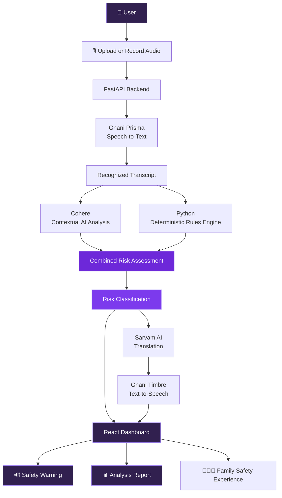
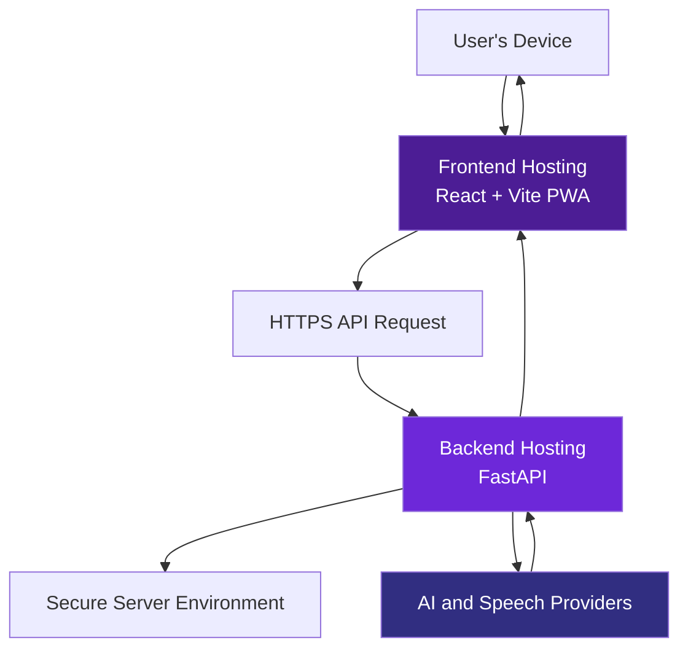

# 🛡️ TRUSTLINE
### The Human Firewall for Voice Scams.

<p align="center">
  
  
</p>

<p align="center">
  <strong>Hear the call. Understand the risk. Protect the decision.</strong>
</p>

<p align="center">
  An AI-powered voice scam protection companion that combines speech recognition, contextual intelligence, deterministic safety rules, multilingual communication, and spoken warnings to help people recognize suspicious conversations.
</p>

<p align="center">
  <a href="https://github.com/ManyaValecha/TRUSTLINE">Repository</a> ·
  <a href="#-how-it-works">Architecture</a> ·
  <a href="#-getting-started">Installation</a> ·
  <a href="#-privacy-security">Privacy</a> ·
  <a href="#-roadmap">Roadmap</a>
</p>

<p align="center">
  
  
  
  
  
  
  
</p>

---

## ◈ The idea behind TRUSTLINE

**A convincing voice is not proof of a trustworthy person.**

Imagine receiving a call from someone claiming to represent your bank.

They sound confident. They know how to create urgency. They ask you to verify an OTP, share a UPI PIN, install a remote-access application, or transfer money immediately.

In that moment, the biggest vulnerability is not necessarily technology.

It is the pressure to make a decision before recognizing the danger.

TRUSTLINE is built to introduce a layer of awareness between a suspicious conversation and a potentially irreversible decision.

It turns voice conversations into understandable risk signals and actionable safety guidance.

> **Our philosophy: Don't just detect suspicious words. Help people understand suspicious behaviour.**

## ◈ What is TRUSTLINE?

TRUSTLINE is an AI-powered voice scam protection Progressive Web App (PWA).

It accepts audio that users explicitly choose to upload or record, converts speech into text, analyzes the conversation using AI and independent deterministic rules, and presents an understandable risk assessment with multilingual and spoken warnings.

Instead of trusting a single AI-generated answer, TRUSTLINE uses a layered analysis approach.

### The TRUSTLINE approach

| Layer | Responsibility |
|---|---|
| Speech intelligence | Understand what was said |
| Contextual AI | Identify suspicious intent and conversational patterns |
| Deterministic rules | Check for specific high-risk scam behaviours |
| Risk assessment | Combine available evidence |
| Language accessibility | Translate safety guidance |
| Voice feedback | Deliver warnings through speech |
| User experience | Make risk information understandable and actionable |

**Important distinction:** TRUSTLINE focuses on behavioural scam detection. It does not currently claim to detect AI-generated voices, clone voices, or deepfakes.

---

# ◈ The product experience

## 01 — Capture

<kbd>USER-CONTROLLED AUDIO</kbd>

Users can provide an audio sample through the application's audio upload or recording experience.

Audio analysis is initiated by the user, rather than by hidden background monitoring.

## 02 — Understand

<kbd>SPEECH-TO-TEXT</kbd>

Gnani Prisma converts the audio into a transcript that can be analyzed for suspicious language and intent.

## 03 — Investigate

<kbd>MULTI-LAYER INTELLIGENCE</kbd>

Cohere analyzes the transcript while a separate deterministic rules engine checks for high-risk indicators.

## 04 — Assess

<kbd>RISK INTERPRETATION</kbd>

The analysis pipeline combines AI and rule-based evidence to generate a risk assessment.

## 05 — Communicate

<kbd>MULTILINGUAL + VOICE FEEDBACK</kbd>

Sarvam translates safety guidance, and Gnani Timbre generates spoken warnings.

## 06 — Protect

<kbd>UNDERSTANDABLE ACTION</kbd>

The frontend presents analysis results and safety guidance so users can make more informed decisions.

---

# ◈ How it works

## System architecture

The following diagram represents the complete intended processing flow of the current MVP.



## The analysis pipeline

### Stage 1 — Audio ingestion

**Input:** User-authorized audio.

The frontend provides audio upload and recording components. The selected audio is submitted to the backend for processing.

### Stage 2 — Speech recognition

**Technology:** Gnani Prisma

The speech recognition service converts audio into a textual transcript.

The transcript becomes the common input for the subsequent analysis stages.

### Stage 3 — AI-powered contextual analysis

**Technology:** Cohere

The AI analysis service evaluates the transcript for contextual indicators such as:

- Suspicious requests for sensitive information.
- Impersonation and false authority.
- Financial manipulation.
- Urgency and coercive language.
- Attempts to influence the user's decisions.

AI analysis provides contextual understanding rather than relying exclusively on isolated keywords.

### Stage 4 — Independent deterministic safety engine

**Technology:** Python

The rules engine independently evaluates predefined high-risk patterns.

Examples include:

| Risk indicator | Example behaviour |
|---|---|
| OTP harvesting | Asking the user to disclose an OTP |
| UPI PIN requests | Requesting a payment PIN |
| Payment pressure | Demanding an immediate transfer |
| Impersonation | Pretending to represent a bank or authority |
| Remote access | Asking the user to install remote-control software |
| Threats | Using fear or consequences to force compliance |
| Secrecy | Telling the user not to inform family or authorities |

The purpose of this layer is to provide explicit safety checks alongside AI interpretation.

### Stage 5 — Combined risk assessment

The pipeline combines the available AI and rule-based signals.

This creates a layered assessment rather than relying on an isolated model response.

The assessment is intended to support risk interpretation, not to guarantee that a conversation is fraudulent or safe.

### Stage 6 — Translation

**Technology:** Sarvam AI

Safety messages can be translated to improve accessibility for users who prefer Indian languages.

### Stage 7 — Spoken warning generation

**Technology:** Gnani Timbre

Text-based safety guidance is converted into audio so that users can hear the warning.

### Stage 8 — Frontend presentation

The React application presents the analysis through its dashboard and report components.

The product experience is designed to make technical risk information understandable to ordinary users.

---

# ◈ Technology architecture

## Frontend

| Technology | Role |
|---|---|
| React | Component-based user interface |
| TypeScript | Type safety and maintainability |
| Vite | Development and build tooling |
| PWA tooling | Progressive Web App capabilities |
| Service Workers | Offline and installation-related capabilities |
| CSS | Responsive visual interface |

### Frontend components

The application is organized into reusable components and pages.

| Component / Module | Responsibility |
|---|---|
| `AudioRecorder` | Audio recording interface |
| `AudioUploader` | Audio upload interface |
| `SampleAudioSelector` | Sample audio selection |
| `AnalysisReportView` | Analysis report presentation |
| `AnalysisTimeline` | Analysis timeline |
| `RiskBadge` | Risk status presentation |
| `ProtectionCard` | Protection dashboard component |
| `OfflineIndicator` | Network status feedback |
| `usePWAInstall` | PWA installation experience |
| `api.ts` | Backend API communication |
| `AppContext` | Shared application state |

## Backend

| Technology | Role |
|---|---|
| Python | Backend implementation |
| FastAPI | REST API framework |
| Gnani Prisma | Speech recognition |
| Cohere | Contextual transcript analysis |
| Sarvam AI | Translation |
| Gnani Timbre | Spoken warning generation |
| Python rules engine | Deterministic scam-pattern checks |

### Backend services

| File | Responsibility |
|---|---|
| `main.py` | FastAPI application entry point |
| `scam_engine/rules.py` | Deterministic safety rules |
| `services/gnani_stt.py` | Speech-to-text integration |
| `services/cohere_analyzer.py` | AI transcript analysis |
| `services/sarvam_translator.py` | Translation integration |
| `services/gnani_tts.py` | Text-to-speech integration |
| `services/pipeline.py` | Analysis orchestration |

---

# ◈ Repository structure

```text
TRUSTLINE/
│
├── backend/
│   ├── app/
│   │   ├── main.py
│   │   │
│   │   ├── scam_engine/
│   │   │   └── rules.py
│   │   │
│   │   └── services/
│   │       ├── cohere_analyzer.py
│   │       ├── gnani_stt.py
│   │       ├── gnani_tts.py
│   │       ├── pipeline.py
│   │       └── sarvam_translator.py
│   │
│   ├── tests/
│   │   ├── manual_test_cohere.py
│   │   ├── manual_test_combination.py
│   │   ├── manual_test_false_positive.py
│   │   ├── manual_test_gnani.py
│   │   ├── manual_test_gnani_tts.py
│   │   ├── manual_test_pipeline.py
│   │   ├── manual_test_rules.py
│   │   ├── manual_test_sarvam.py
│   │   └── manual_test_scam.py
│   │
│   ├── requirements.txt
│   └── .gitignore
│
├── frontend/
│   ├── public/
│   ├── src/
│   │   ├── components/
│   │   │   ├── analysis/
│   │   │   ├── audio/
│   │   │   ├── common/
│   │   │   ├── dashboard/
│   │   │   ├── landing/
│   │   │   └── layout/
│   │   │
│   │   ├── context/
│   │   ├── hooks/
│   │   ├── pages/
│   │   ├── services/
│   │   └── types/
│   │
│   ├── App.tsx
│   ├── main.tsx
│   ├── index.css
│   ├── package.json
│   ├── tsconfig.json
│   └── vite.config.ts
│
└── README.md
```

---

# ◈ Getting started

Run TRUSTLINE locally by setting up the backend and frontend separately.

## Requirements

Before starting, install:

- Python 3.10 or later.
- Node.js and npm.
- Git.
- Provider credentials are needed only for live audio analysis. The built-in simulated examples require no audio upload or provider credentials.

## 1. Clone the repository

```bash
git clone https://github.com/ManyaValecha/TRUSTLINE.git
cd TRUSTLINE
```

## 2. Configure the backend

```bash
cd backend

python3 -m venv venv
source venv/bin/activate

pip install -r requirements.txt
```

For live provider-backed audio analysis only, configure credentials in a local `.env` file inside `backend/`. The prewritten simulation flow does not need them. Keep that file private and out of Git.

```env
GNANI_API_KEY_ID=your_gnani_key
COHERE_API_KEY=your_cohere_key
SARVAM_API_KEY=your_sarvam_key
```

Use the providers’ official account setup for any credentials you configure locally. Do not paste credentials into chat, put them in frontend variables, commit `.env`, or publish API keys.

Start the backend:

```bash
uvicorn app.main:app --reload
```

The local API should be available at:

```text
http://127.0.0.1:8000
```

### Backend health check

Open:

```text
http://127.0.0.1:8000/health
```

The development API documentation is available at:

```text
http://127.0.0.1:8000/docs
```

## 3. Configure the frontend

Open a second Terminal window.

```bash
cd TRUSTLINE/frontend

npm install
```

Create your local environment file:

```bash
cp .env.example .env
```

Set the backend URL:

```env
VITE_API_BASE_URL=http://127.0.0.1:8000
```

Start the frontend:

```bash
npm run dev
```

Open the local URL printed by Vite.

## 4. Run the complete application

Keep both development servers running:

| Service | Local address |
|---|---|
| Frontend | Vite development URL |
| Backend | `http://127.0.0.1:8000` |
| API documentation | `http://127.0.0.1:8000/docs` |
| Health endpoint | `http://127.0.0.1:8000/health` |

The frontend communicates with the FastAPI backend using the configured API base URL.

---

# ◈ API and integration overview

The backend provides an analysis workflow through its FastAPI application.

| Resource | Purpose |
|---|---|
| `/health` | Backend health verification |
| `/docs` | Interactive API documentation |
| `/api/analyze` | Audio analysis workflow |

The `/api/analyze` workflow is used for the end-to-end audio analysis integration.

The exact request and response schemas are maintained by the backend implementation and can be inspected through the interactive API documentation.

### External service integrations

| Provider | Integration | Purpose |
|---|---|---|
| Gnani | Prisma | Speech-to-text |
| Cohere | Language model API | Transcript intelligence |
| Sarvam | Translation API | Multilingual safety communication |
| Gnani | Timbre | Text-to-speech |

All provider credentials should remain server-side.

---

# ◈ Privacy & security

## Safety starts with responsible data handling.

Voice recordings may contain personal, financial, and sensitive information. TRUSTLINE treats privacy as a core product requirement.

### Current design principles

- **User authorization:** Audio processing is initiated through an explicit user action.
- **No hidden call surveillance:** The current browser-based MVP does not monitor ordinary cellular calls in the background.
- **Server-side credentials:** AI and speech provider credentials are stored in backend environment variables.
- **No frontend secrets:** Provider API keys must never be exposed through Vite environment variables or browser code.
- **Data handling:** Audio is sent to the backend and external providers. The browser stores reports, including transcripts, in localStorage; generated warning audio may remain on the backend filesystem.
- **Family contacts:** Contact details are stored in local browser state. The current application does not send contact invitations or alerts.
- **Transparent risk communication:** A low-risk result does not guarantee that a conversation is safe.

### Security checklist

| Security area | Requirement |
|---|---|
| API credentials | Environment variables |
| Git protection | `.gitignore` excludes private files |
| Audio data | 20 MiB request limit; external/provider and hosting retention must be checked |
| Transport | HTTPS in production |
| CORS | Restrict to trusted frontend origins |
| Family notifications | Not implemented; no messages are delivered |
| Error handling | Avoid leaking credentials or sensitive transcripts |

> **A safety warning is not a financial guarantee.** Users should independently verify unexpected payment requests and never disclose OTPs, UPI PINs, passwords, or banking credentials.

---

# ◈ Testing and evaluation

A scam-protection product must be evaluated against both malicious and legitimate conversations.

Testing should cover more than whether the AI can identify obvious scam phrases.

### Important test categories

| Test category | What to verify |
|---|---|
| OTP requests | Detection of sensitive credential requests |
| UPI PIN requests | Detection of payment credential harvesting |
| Urgent transfers | Recognition of financial pressure |
| Impersonation | Recognition of false authority |
| Remote access | Detection of suspicious installation requests |
| Threats | Recognition of coercive language |
| Legitimate banking conversations | Avoiding unnecessary warnings |
| Ordinary conversations | Avoiding over-classification |
| Multilingual audio | Speech recognition and translation quality |
| Audio generation | Correct spoken warning output |

### Evaluation metrics

| Metric | Meaning |
|---|---|
| Precision | Proportion of flagged conversations that are genuinely suspicious |
| Recall | Proportion of suspicious conversations correctly identified |
| False Positive Rate | Proportion of legitimate conversations incorrectly flagged |
| False Negative Rate | Proportion of suspicious conversations missed |
| F1 Score | Harmonic mean of precision and recall |

A reproducible **synthetic text-only pilot** contains 220 authored transcripts from 35 scenario families. The current deterministic rules run reports 98.6% accuracy, 97.5% recall, and 0.0% FPR over those authored examples; on a grouped 44-record re-partition, recall is 87.5% and three courier/customs scams are missed. The development split reaches 100%, which indicates template fit. The new split is not independent or blind validation, and the scores are **not real-world performance estimates**. The improvement run covers all Hindi scam examples in this pilot, but this does not establish reliable multilingual performance outside it. AI-only, provider-backed hybrid, and full audio pipeline metrics are unavailable. Review the [improvement report](docs/DETECTION_IMPROVEMENTS.md), [evaluation report](docs/EVALUATION_REPORT.md), and [methodology](docs/EVALUATION_METHODOLOGY.md) before interpreting the figures.

Reproduce from the repository root with `cd backend && PYTHONPATH=.. python -m evaluation.generate_dataset && PYTHONPATH=.. python -m evaluation.run_benchmark`. Run software checks with `cd backend && PYTHONPATH=. python -m pytest -q -p no:cacheprovider`.

---

# ◈ Product interface

The repository includes the following frontend experiences:

| Page | Purpose |
|---|---|
| Landing | Introduces the product and its value |
| Onboarding | Introduces the user to the application |
| Dashboard | Central protection interface |
| Analysis | Presents conversation analysis |
| How It Works | Explains the protection workflow |
| Family | Family safety experience |
| Settings | Application preferences |
| Evaluation | Synthetic benchmark results, breakdowns, and limitations |

## Screenshots

A polished product README should show the actual application, not just its source code.

Screenshots are not included in the repository yet. Add real captures after verifying the application in a browser; no placeholder image links are used here.

---

# ◈ Engineering decisions

## Verified implementation status

- The deterministic rules emit typed, exact transcript spans. The ordinal rule weight is not a probability.
- The Cohere response is checked against a Pydantic schema and unsupported quotations are rejected.
- A Cohere failure leaves a clearly marked deterministic-only result; translation and spoken guidance have text fallbacks.
- Demo/sample reports are labeled as simulations and do not claim provider calls. Low risk is described as “no major indicators found,” not as proof a conversation is safe.
- Trusted contacts are saved locally only; the app does not deliver alerts.
- The offline pytest suite can be run with `cd backend && PYTHONPATH=. python -m pytest -q -p no:cacheprovider`. Provider scripts beginning `manual_test_` are separate and may require credentials/external calls.

See [Architecture](docs/ARCHITECTURE.md), [Detection Methodology](docs/DETECTION_METHODOLOGY.md), [Detection Error Analysis](docs/DETECTION_ERROR_ANALYSIS.md), [Detection Improvements](docs/DETECTION_IMPROVEMENTS.md), [Evaluation Methodology](docs/EVALUATION_METHODOLOGY.md), [Evaluation Report](docs/EVALUATION_REPORT.md), [Security and Privacy](docs/SECURITY_AND_PRIVACY.md), [Deployment](docs/DEPLOYMENT.md), [Known Limitations](docs/KNOWN_LIMITATIONS.md), [Demo Script](docs/DEMO_SCRIPT.md), [Pitch Deck Outline](docs/PITCH_DECK_OUTLINE.md), and [Judge Q&A](docs/COMPETITION_DEMO.md), [Competition Readiness Audit](docs/COMPETITION_READINESS_AUDIT.md), and the [Final Implementation Plan](docs/FINAL_IMPLEMENTATION_PLAN.md) for implementation details and remaining gaps.

## Why combine AI with deterministic rules?

AI can understand context and interpret language, but safety-critical applications should not depend on one probabilistic response.

A deterministic rules layer provides explicit checks for predefined high-risk behaviours.

Combining the two allows TRUSTLINE to consider both contextual interpretation and clearly defined safety indicators.

## Why speech recognition first?

Speech must become machine-readable before contextual transcript analysis can take place.

Speech-to-text creates a common representation that can be passed through AI analysis and rule-based checks.

## Why multilingual warnings?

Scam awareness is only useful when people can understand the warning.

Multilingual support is intended to make safety guidance more accessible across language preferences.

## Why spoken alerts?

A spoken warning creates an additional way to receive safety information beyond reading a report on a screen.

---

# ◈ Deployment architecture

TRUSTLINE is structured as a frontend and backend application.

A production deployment can use:



### Suggested hosting arrangement

| Layer | Possible platform |
|---|---|
| Source code | GitHub |
| Frontend | Vercel |
| Backend | Render |
| Credentials | Backend hosting environment variables |

### Production deployment checklist

- [ ] Deploy the FastAPI backend.
- [ ] Configure backend environment variables.
- [ ] Configure production CORS origins.
- [ ] Deploy the React frontend.
- [ ] Set the production API base URL.
- [ ] Verify the backend health endpoint.
- [ ] Test audio upload and analysis.
- [ ] Test translation and generated warnings.
- [ ] Review recording retention and storage.
- [ ] Verify HTTPS and error handling.
- [ ] Conduct production security testing.

**Repository hosting is not the same as application hosting.** GitHub stores the project source code; the frontend and backend require separate runtime hosting.

---

# ◈ Roadmap

TRUSTLINE is an evolving product. The roadmap separates the working foundation from future improvements.

### Foundation

- [x] Initialize the GitHub repository.
- [x] Build the FastAPI backend foundation.
- [x] Integrate speech-to-text.
- [x] Integrate AI transcript analysis.
- [x] Implement deterministic scam-pattern rules.
- [x] Integrate translation.
- [x] Integrate spoken warning generation.
- [x] Build the React frontend.
- [x] Establish the PWA foundation.
- [ ] Run a credentialed end-to-end backend integration test.

### Next engineering milestones

- [ ] Expand multilingual test coverage.
- [x] Create a synthetic text-only evaluation pilot and rules-only runner (not representative validation).
- [x] Improve risk explanations and evidence presentation, including family-friendly English/Hindi guidance.
- [ ] Evaluate false positives and false negatives systematically.
- [ ] Validate trusted-family notification workflows.
- [ ] Complete production deployment.
- [ ] Conduct a privacy and security review.
- [ ] Perform accessibility and usability testing.
- [ ] Improve production monitoring and reliability.

---

# ◈ Contributing

Ideas, improvements, bug reports, and constructive feedback are welcome.

### Contribution workflow

1. Fork the repository.
2. Create a feature branch.
3. Implement your improvement.
4. Run the relevant tests.
5. Open a pull request with a clear description.

```bash
git checkout -b feature/your-feature

git add .

git commit -m "Add: describe your improvement"

git push origin feature/your-feature
```

For substantial changes, please describe:

- The problem being addressed.
- The proposed solution.
- Any relevant screenshots.
- Testing performed.
- Privacy or security implications.

---

# ◈ Project information

**Project:** TRUSTLINE  
**Category:** Artificial Intelligence · Cybersecurity · Voice Safety · Progressive Web Apps

**Creator:** [Manya Valecha](https://github.com/ManyaValecha)

**Repository:** [github.com/ManyaValecha/TRUSTLINE](https://github.com/ManyaValecha/TRUSTLINE)

## License

No open-source license has been added yet. Unless a license is included in the repository, all rights remain reserved.

---

<p align="center">
  
</p>

<h3 align="center">A safer conversation starts with awareness.</h3>

<p align="center">
  <strong>Listen carefully. Recognize the signs. Protect the decision.</strong>
</p>

<p align="center">
  Built with purpose. Engineered for awareness. 💜
</p>
