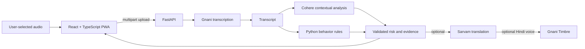

# Architecture

## Components

- `frontend/src`: React pages/components, API client, PWA registration and local application state.
- `backend/app/main.py`: FastAPI endpoints, upload validation, CORS, and configuration health report.
- `backend/app/services`: provider adapters and orchestration.
- `backend/app/scam_engine/rules.py`: deterministic behavior rules.
- `backend/app/schemas.py`: strict Pydantic detection signal and rule result contracts.
- `backend/tests`: offline pytest suite. Provider integration scripts prefixed `manual_test_` are intentionally not part of the default test run because they require credentials and can incur external calls.

## Data flow and trust boundaries

Audio is uploaded to the backend and sent to Gnani for transcription. The transcript is sent to Cohere and detected safety text is sent to Sarvam when configured. The browser stores profile/settings, contact details, and up to 30 recent analysis records in localStorage; records include transcripts and report data. The backend writes generated warning speech to a local storage path. Hosting and provider retention practices have not been verified by this repository review.

Cohere output is schema-validated and evidence must be a substring of the transcript. Rule output is validated using Pydantic. External provider responses remain untrusted, and errors are returned to clients without provider exception details.

## Current endpoints

- `GET /`: basic backend process response.
- `GET /health`: process status and whether provider credentials are configured. It does not call the providers and does not measure provider availability.
- `POST /api/analyze`: multipart audio plus `speech_language` and `target_language` query parameters; uploads are limited to 20 MiB.
- `GET /api/warnings/audio`: serves the generated warning audio if present.

The backend does not intercept cellular calls, run analysis offline, send trusted-contact notifications, or report incidents to authorities.
